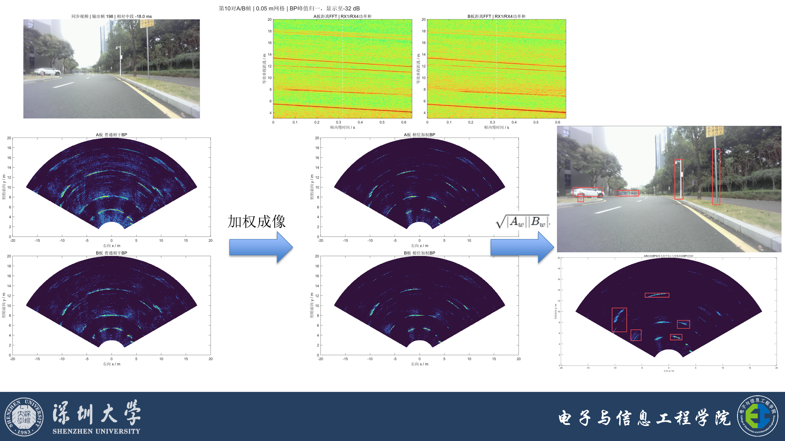
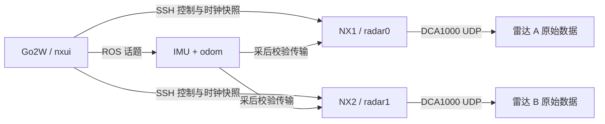

# Go2W 双雷达采集系统

Go2W 负责发起采集并记录 ROS IMU、里程计；两台 Jetson NX 各负责一套 AWR2243 + DCA1000 的雷达原始数据。预配置后，机器狗统一启动两站录制、保存时间戳并核对原始帧质量。

> 图为用户提供的 MATLAB 实验效果预览，不代表 I/Q 字序、外参、曝光时刻或最终成像精度已完成物理标定。仓库不包含原始采集数据。

| 设备 | 项目目录 | 运行数据 | 主要任务 |
| --- | --- | --- | --- |
| 机器狗 NX | `~/NX_radar_fleet` | `data/sessions/`、`logs/` | 控制双站，记录 `/dog_imu_raw` 与 `/unitree/slam_mapping/odom`，保存时钟快照 |
| 雷达站 NX1 | 自选目录，例如 `~/pyRadar-main` | `data/sessions/`、`logs/` | radar0，雷达必需，相机可选 |
| 雷达站 NX2 | 自选目录，例如 `~/radar_capture_workspace` | `data/sessions/`、`logs/` | radar1，雷达必需，相机可选 |

## 当前采集配置

默认使用**双雷达软件触发**配置：TX0、RX0/RX3、77 GHz 起始频率、约 25 MHz/μs 斜率、每 RX 每 chirp 1200 个 Complex 1x 采样点、每帧 256 chirp、650 ms 帧周期。单站每帧原始数据应为 **2,457,600 字节**。硬触发 TDM 配置保留为可选项，只有 STM32 串口及 A/B 触发线接好后才选用。详见[参数与配置](docs/RADAR_CONFIG.md)。

## 使用顺序

1. 按[雷达站部署说明](radar_station/README.md)配置一台或两台 NX；单站测试只启用 `radar0`，双站时再启用 `radar1`，确认 DCA 网口和雷达供电。
2. 按[机器狗部署说明](dog/README.md)配置 ROS 环境、SSH 凭据和两站 IP。正式采集使用机器狗到两台 NX 的**有线** `192.168.55.1/56.1`；`192.168.3.x` Wi‑Fi 只用于调试或明确授权的短测。
3. 在机器狗运行 `nxui`：选项 1 设置 IP，选项 2 选雷达配置，选项 3 选模式，选项 4 预检并预配置，选项 5 开始录制。选项 4 会直接指出时间、路由、SSH、DCA 或传感器错误。
4. 每次实验后检查三端 `data/sessions/<会话名>/` 的 manifest、原始帧大小、补零字节数及时间快照。正式数据分析以实际落盘质量报告为准。

时间同步有两个层次：机器狗先由 `rtc0` 恢复时间并通过 chrony/NTP 校准；每次采集前后又测量机器狗与 NX1/NX2 的时钟偏差。雷达帧时间目前取自 NX 收到首个 UDP 包的**主机时间代理**，不是 STM32 边沿或摄像头曝光时间。详见[时间与质量说明](docs/TIME_AND_QUALITY.md)。

## 目录与来源

- [`dog/`](dog/README.md)：机器狗控制程序、Go2W ROS 源码、服务模板、配置样例。
- [`radar_station/`](radar_station/README.md)：NX1/NX2 共用的雷达站源码和波形配置；设备差异只在配置文件。
- [`docs/reference/雷达参数.pptx`](docs/reference/雷达参数.pptx)：用户提供的雷达参数教程。其通用示例不等于本系统当前波形。
- [`docs/images/matlab_bp_demo.png`](docs/images/matlab_bp_demo.png)：用户提供的实验结果图。

雷达采集核心参考 [gaoweifan/pyRadar](https://github.com/gaoweifan/pyRadar)，原项目采用 MIT 许可；相关版权声明保留在 [`radar_station/LICENSE.pyRadar`](radar_station/LICENSE.pyRadar)。本仓库供内部研发，发布时必须创建为 **Private**。不得提交密码、私钥、原始 `.bin`、视频或会话日志；实际凭据仅保存在设备本地的受限环境文件中。完整复制结构见[发布与复制说明](docs/RELEASE_LAYOUT.md)。
