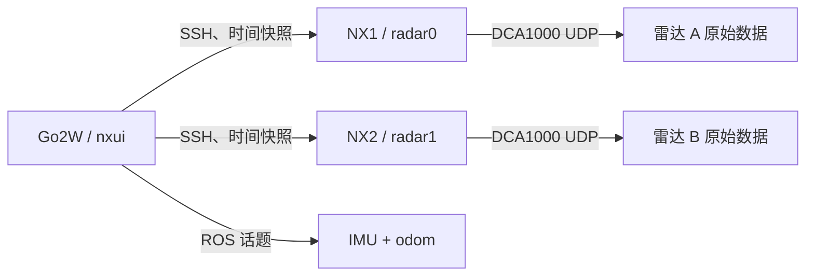

# Go2W 双雷达采集

这套工程把 Go2W、NX1 和 NX2 放进同一条采集流程：机器狗负责发起采集，并记录 IMU、里程计和各端时间；每台 NX 负责一套 AWR2243 + DCA1000 雷达原始数据。雷达侧相机和串口 IMU 是可选项，雷达本身不能缺席。

> 图片是一次 MATLAB 实验结果，用来展示后处理效果。它不代表当前工程已经完成 I/Q 字序、外参或曝光时刻标定。仓库不放原始采集数据。

## 设备分工

| 设备 | 部署目录 | 负责内容 |
| --- | --- | --- |
| Go2W 机器狗 | `~/NX_radar_fleet` | 运行 `nxui`，远程控制雷达站，记录 `/dog_imu_raw` 和 `/unitree/slam_mapping/odom` |
| 雷达 NX1 | 例如 `~/radar_station` | 运行 radar0，接收 DCA1000 UDP 并保存原始帧 |
| 雷达 NX2 | 例如 `~/radar_station` | 运行 radar1，代码与 NX1 相同，只改站点配置 |

## 当前默认配置

默认波形是双雷达软件触发版本：TX0、RX0/RX3、77 GHz、约 25 MHz/μs、10 MSps、每 chirp 1200 个复数点、每帧 256 个 chirp、帧周期 650 ms。按这个配置，一个完整雷达帧应为 **2,457,600 字节**。

硬件触发版本也放在 `radar_station/configFiles/`，只有 STM32 和 A/B 触发线接好后才使用。

## 快速开始

1. 按 [雷达站说明](radar_station/README.md) 在 NX 上安装依赖、配置 DCA 网口和雷达波形。
2. 按 [机器狗说明](dog/README.md) 编译 ROS 工作空间，并填写两台 NX 的地址和 SSH 凭据。
3. 在机器狗运行 `~/NX_radar_fleet/tools/nxui`：先选雷达和模式，再做预检，最后开始采集。
4. 采集结束后，检查三端会话目录里的 manifest、帧大小、补零字节和时间快照。

正式采集使用机器狗到 NX1/NX2 的有线网口 `192.168.55.1`、`192.168.56.1`。Wi-Fi 只适合调试和短测。

## 常用入口

- 机器狗：`~/NX_radar_fleet/tools/nxui`
- 雷达站：`~/radar_station/run_radar_station.sh`
- 机器狗端说明：[dog/README.md](dog/README.md)
- 雷达端说明：[radar_station/README.md](radar_station/README.md)
- 目录复制说明：[docs/RELEASE_LAYOUT.md](docs/RELEASE_LAYOUT.md)

## 参考资料

- [雷达参数教程](docs/reference/雷达参数.pptx)：mmWave Studio、chirp/frame 和 DCA1000 的配置说明。
- [MATLAB 成像示例](docs/images/matlab_bp_demo.png)：一次实际实验的结果图。

## 数据和时间

每台设备把代码、日志和数据放在自己的项目目录中：`data/sessions/` 保存会话，`logs/` 保存运行日志。雷达帧时间是 NX 收到首个 UDP 包时的主机时间代理，不等于实际发射边沿；机器狗会在采集前后记录三端时间快照，后处理再把雷达、IMU 和 odom 放到同一时间轴。详细约定见 [docs/TIME_AND_QUALITY.md](docs/TIME_AND_QUALITY.md)。

## 代码来源和仓库边界

雷达 UDP 读取部分参考 [gaoweifan/pyRadar](https://github.com/gaoweifan/pyRadar)，许可证保留在 `radar_station/LICENSE.pyRadar`。这个仓库用于内部研发，保持 **Private**。密码、私钥、原始 `.bin`、视频、会话日志和 Jetson 平台 `.so` 都不提交到 Git。
